# LIFELY – Kiến trúc và sơ đồ (Mermaid)

Các sơ đồ dưới đây viết bằng Mermaid, xem được trực tiếp trên GitHub hoặc VS Code (extension "Markdown Preview Mermaid Support"), và dùng làm nền để vẽ lại UML trong báo cáo đồ án.

> Tài liệu này được đối chiếu với mã nguồn hiện tại: schema theo Flyway **V1 → V16**, trạng thái theo các enum trong `backend/src/main/java/com/lifely`, luồng nghiệp vụ theo các lớp `*Service`. Khi sửa code, hãy cập nhật sơ đồ tương ứng.

**Hai khái niệm dễ nhầm, được dùng xuyên suốt tài liệu:**

| Cột | Ý nghĩa | Ai làm thay đổi |
|---|---|---|
| `blood_requests.units_confirmed` | Số người hiến **đã nhận lời** (chưa phải lượng máu đã hiến) | `MatchService.accept` (+1), `markNoShow` (−1) |
| `blood_requests.units_received` | Số đơn vị **đã được cơ sở / bên điều phối xác nhận hiến thực tế** | `MatchService.complete` |

Yêu cầu chỉ chuyển sang `FULFILLED` khi `units_received = units_required`. Đủ người nhận lời chỉ làm hệ thống **ngừng mời thêm**.

## 1. Kiến trúc hệ thống
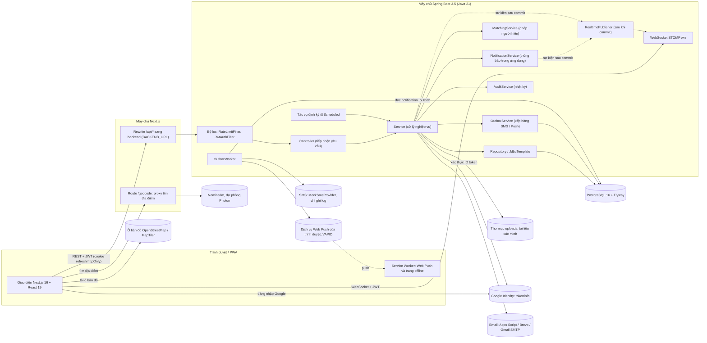

### Tác vụ định kỳ

| Tác vụ | Lớp | Chu kỳ | Việc làm |
|---|---|---|---|
| Hết hạn yêu cầu | `RequestExpiryJob` | 60 giây | Chuyển yêu cầu quá hạn sang `EXPIRED`, hết hiệu lực các lời mời chưa phản hồi |
| Leo thang | `EscalationJob` | 30 giây | Mở rộng bán kính tìm người hiến theo cấp 1 → 4 |
| Gửi SMS / Push | `OutboxWorker` | 10 giây | Gửi các tin trong `notification_outbox` sau khi nghiệp vụ đã commit |
| Nhắc lịch hẹn | `AppointmentReminderJob` | 5 phút | Nhắc lịch `BOOKED` sắp tới giờ (mặc định trước 24 giờ) |
| Nhắc hiến lại | `RejoinReminderJob` | 1 giờ | Báo người hiến đã đủ giãn cách để hiến lại |
| Dọn refresh token | `RefreshTokenService.purgeExpired` | 03:30 hằng ngày | Xóa refresh token hết hạn |
| Báo cáo tuần | `SummaryReportService` | 08:00 thứ Hai (giờ Việt Nam) | Gửi email thống kê cho admin |
| Dời deadline dữ liệu demo | `DemoDataRefresher` | Lúc khởi động | Chỉ khi `DEMO_REFRESH_DEADLINES=true` |

## 2. ERD (sơ đồ quan hệ thực thể)
Schema có 30 bảng nghiệp vụ nên ERD được tách theo nhóm. Mỗi sơ đồ chỉ liệt kê khóa và các cột quan trọng; danh sách cột đầy đủ nằm ở `backend/src/main/resources/db/migration`.

### 2.1 Người dùng, xác thực, người hiến và tổ chức
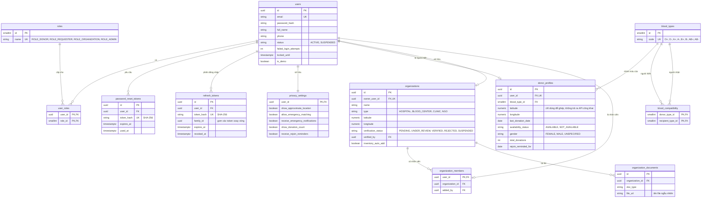

### 2.2 Yêu cầu máu và ghép người hiến
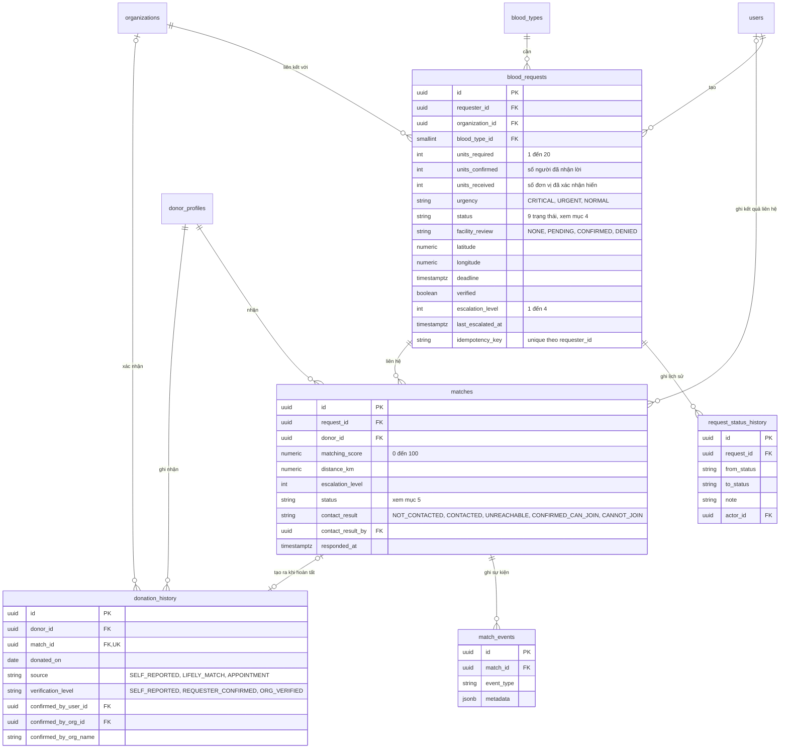
Ràng buộc quan trọng: `UNIQUE (request_id, donor_id)` trên `matches`; `CHECK (units_confirmed <= units_required)` và `CHECK (units_received <= units_required)` trên `blood_requests`.

### 2.3 Lịch hiến máu, kho máu
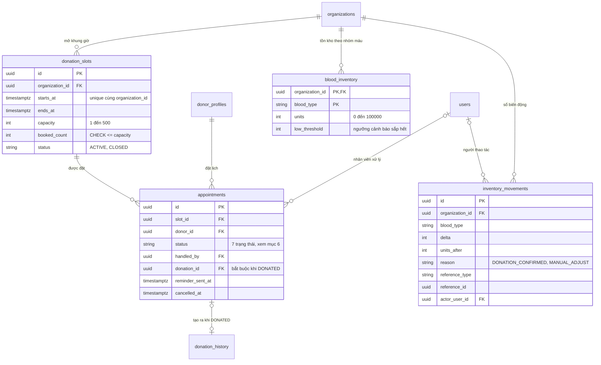
Lịch hẹn **không phải** máu có sẵn: `blood_inventory` chỉ đổi khi nhân viên cơ sở đã xác minh xác nhận hiến máu (và cơ sở bật `inventory_auto_add`), hoặc khi chỉnh tay.

### 2.4 Thông báo, sức khỏe người hiến, báo cáo và nhật ký
```mermaid
erDiagram
  users ||--o{ notifications : "nhận"
  users ||--o{ notification_consents : "đồng ý theo kênh"
  users ||--o{ notification_outbox : "người nhận"
  users ||--o{ push_subscriptions : "thiết bị"
  users ||--o| health_data_consents : "đồng ý lưu dữ liệu sức khỏe"
  donor_profiles ||--o{ donor_health_checks : "đo"
  users ||--o{ reports : "gửi"
  users ||--o{ audit_logs : "thực hiện, không có khóa ngoại"
  users |o--o{ contact_messages : "gửi, có thể ẩn danh"

  notifications {
    uuid id PK
    uuid user_id FK
    string type "14 loại, xem NotificationType"
    boolean is_read
    string reference_type
    uuid reference_id
  }
  notification_consents {
    uuid user_id PK, FK
    string channel PK "SMS, VOICE, PUSH"
    boolean granted "không có dòng = chưa đồng ý"
  }
  notification_outbox {
    uuid id PK
    string dedupe_key UK
    string channel "SMS, PUSH, VOICE cũ đã hủy"
    uuid recipient_user_id FK
    string purpose
    string status "PENDING, SENDING, SENT, FAILED, CANCELLED"
    int attempts
    int max_attempts
    timestamptz next_attempt_at
  }
  push_subscriptions {
    uuid id PK
    uuid user_id FK
    text endpoint UK
    string p256dh
    string auth
  }
  health_data_consents {
    uuid user_id PK, FK
    boolean granted
  }
  donor_health_checks {
    uuid id PK
    uuid donor_id FK
    smallint heart_rate
    smallint systolic
    smallint diastolic
    numeric weight_kg
    string source "SELF_ENTERED, FACILITY"
  }
  reports {
    uuid id PK
    uuid reporter_id FK
    string target_type "REQUEST, USER, ORGANIZATION"
    uuid target_id
    string reason
    string status "OPEN, INVESTIGATING, RESOLVED, REJECTED"
    uuid resolved_by FK
  }
  audit_logs {
    uuid id PK
    uuid user_id
    string action
    string entity_type
    uuid entity_id
    jsonb metadata
  }
  contact_messages {
    uuid id PK
    uuid user_id FK
    string name
    string email
    string status "NEW, READ, RESOLVED"
    uuid handled_by FK
  }
```
Ngoài ra còn bảng `app_metadata` (cặp khóa/giá trị của hệ thống, tạo ở V1) không có quan hệ với bảng nào.

## 3. Phân quyền theo vai trò

| Vai trò | Nhóm endpoint chính |
|---|---|
| Công khai (không cần đăng nhập) | `/api/public/**` (thống kê, yêu cầu công khai, danh sách tổ chức, liên hệ), `/api/health`, `/api/auth/*` (đăng ký, đăng nhập, Google, refresh, quên / đặt lại mật khẩu), `/ws` (bắt tay, xác thực JWT ở CONNECT) |
| `ROLE_DONOR` | `/api/donors/me/**` (hồ sơ, sẵn sàng, quyền riêng tư, lịch sử, sức khỏe), `/api/matches/{id}` và `accept`, `reject`, `/api/slots`, `/api/appointments/**` |
| `ROLE_REQUESTER` | `/api/requests/**` (tạo, sửa, hủy, độ phủ, lịch sử), `/api/matches/{id}/complete`, `no-show`, `contact-result`, `/api/requests/{id}/matches` (cả tổ chức và admin cũng gọi được) |
| `ROLE_ORGANIZATION` | Như người cần máu, cộng thêm `/api/organizations/me/**` (hồ sơ, tài liệu, kho máu, khung giờ, lịch hẹn, nhân viên, nhật ký hiến), `facility-confirm`, `facility-deny`, `delivery/retry` |
| `ROLE_ADMIN` | `/api/admin/**` (người dùng, yêu cầu, tổ chức, báo cáo, nhật ký, kho, lịch hẹn, vận hành, tin nhắn liên hệ) |
| Mọi tài khoản đã đăng nhập | `/api/users/me/**` (xuất / xóa dữ liệu, đồng ý theo kênh), `/api/notifications/**`, `/api/push/**`, `/api/reports` |

## 4. Vòng đời yêu cầu máu
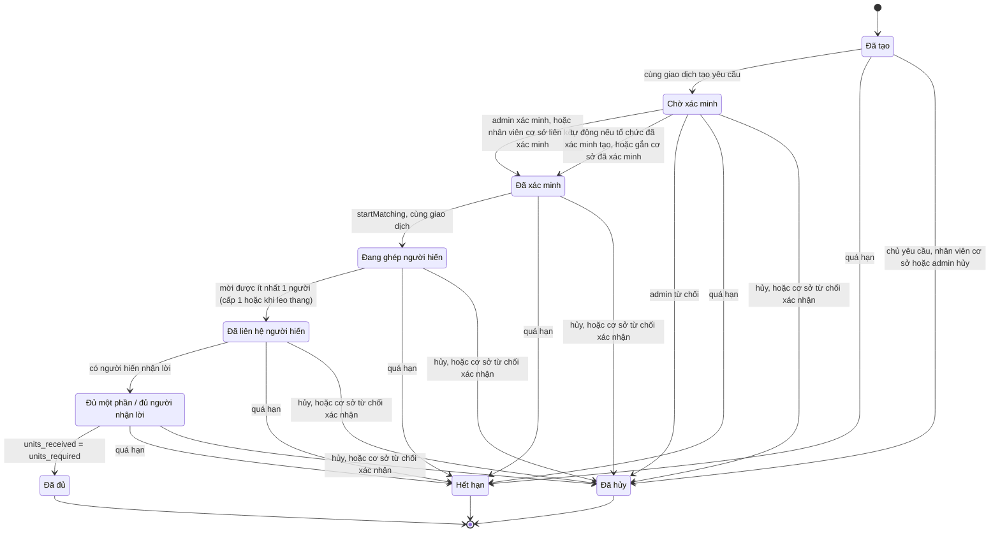
Ghi chú:
- Mọi chuyển trạng thái đều đi qua `RequestLifecycle.transition`: luôn ghi `request_status_history` và phát sự kiện realtime.
- Nhóm trạng thái "đang điều phối" (`RequestStatus.ACTIVE`) gồm `VERIFIED`, `MATCHING`, `DONORS_CONTACTED`, `PARTIALLY_FULFILLED`: hiển thị công khai, được ghép và được leo thang. Hết hạn và hủy áp dụng cho cả `CREATED` và `PENDING_VERIFICATION`.
- Nếu cấp 1 chưa có người hiến phù hợp, yêu cầu **ở lại `MATCHING`** (chỉ ghi chú vào lịch sử) cho tới khi leo thang mời được người.
- `PARTIALLY_FULFILLED` giữ nguyên khi đủ người nhận lời (`units_confirmed = units_required`) và cũng không quay lại khi có người không đến (`units_confirmed` giảm). Chỉ số đơn vị đã xác nhận hiến mới đưa yêu cầu tới `FULFILLED`.
- Yêu cầu gắn với cơ sở đã xác minh có thêm cột `facility_review`: `PENDING` → `CONFIRMED` hoặc `DENIED`. `DENIED` hủy yêu cầu và báo những người đã được mời.

## 5. Trạng thái lượt ghép (`matches.status`)
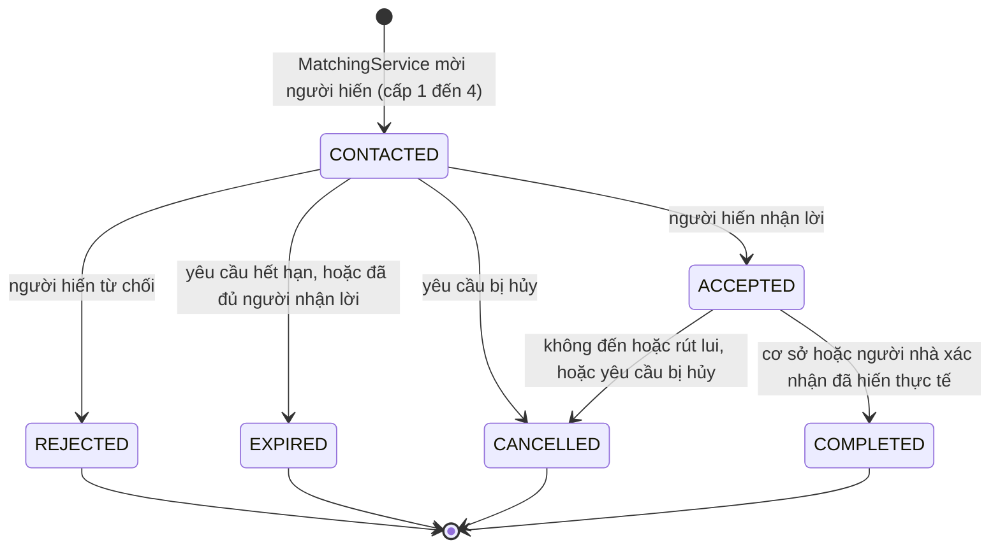
- Giá trị `PENDING` có trong enum và là mặc định của cột, nhưng luồng hiện tại tạo lượt ghép thẳng ở `CONTACTED`.
- Khi yêu cầu **hết hạn**, chỉ các lượt chưa phản hồi chuyển `EXPIRED`; lượt đã `ACCEPTED` giữ nguyên để lưu vết.
- `contact_result` là một trục **độc lập**: nhân viên tự ghi kết quả sau khi gọi bằng liên kết `tel:` (`NOT_CONTACTED`, `CONTACTED`, `UNREACHABLE`, `CONFIRMED_CAN_JOIN`, `CANNOT_JOIN`). Giá trị này không đổi `status`, không cộng đơn vị và không khẳng định người hiến đủ điều kiện. Hệ thống không tự gọi điện.

## 6. Trạng thái lịch hẹn hiến máu (`appointments.status`)
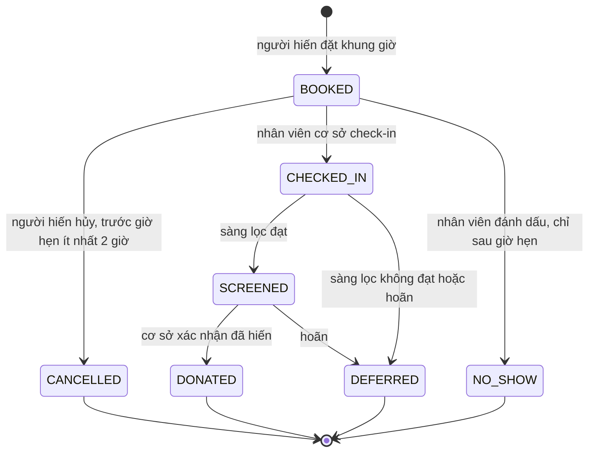
`DONATED` là bước duy nhất ghi `donation_history` (nguồn `APPOINTMENT`, mức `ORG_VERIFIED`), cập nhật `donor_profiles` và cộng kho máu (nếu cơ sở bật tự cộng). Chỉ nhân viên của cơ sở **đã xác minh** mới được chuyển trạng thái.

## 7. Sequence: người hiến chấp nhận (xử lý đồng thời)
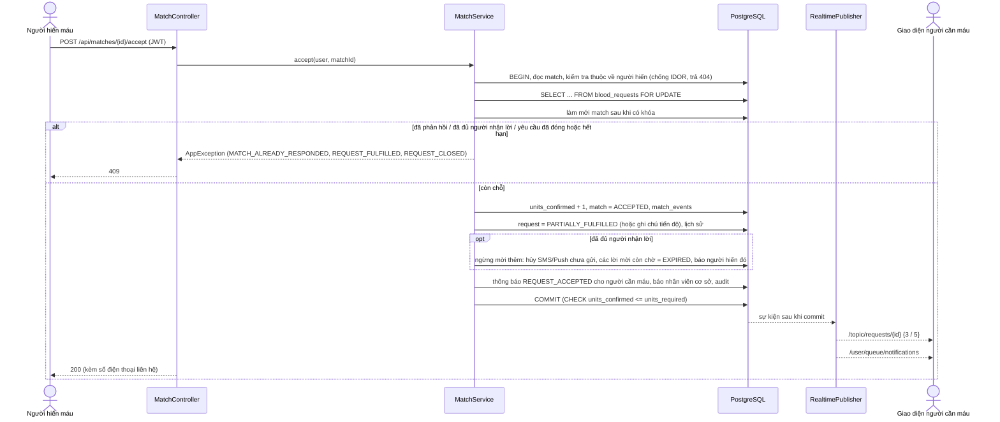

## 8. Sequence: tạo yêu cầu → điều phối
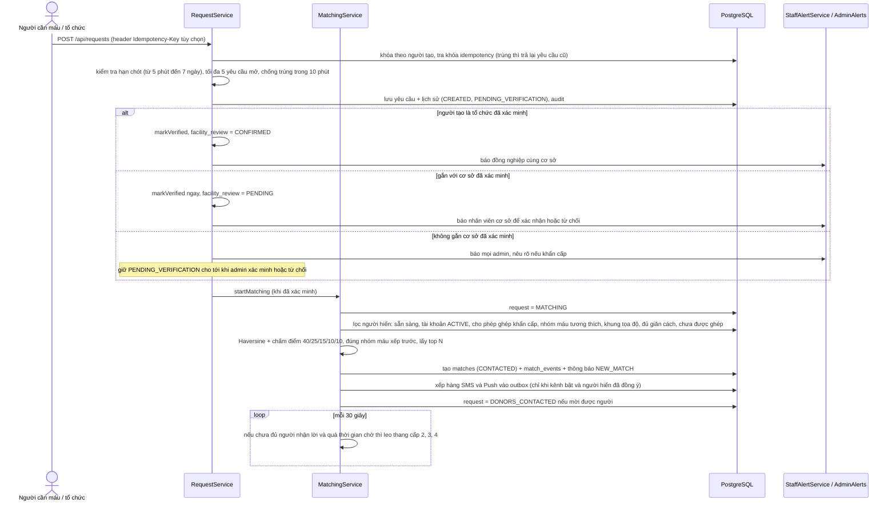

## 9. Sequence: xác nhận đã hiến máu thực tế
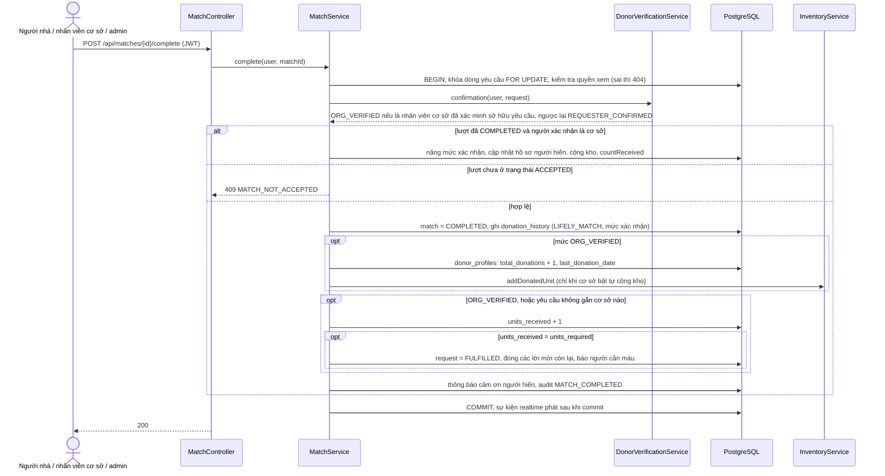
Người nhà xác nhận (mức `REQUESTER_CONFIRMED`) **không** đổi hồ sơ người hiến. Nếu yêu cầu gắn với một cơ sở, lượt hiến chỉ được tính vào `units_received` khi cơ sở xác nhận.

## 10. Sequence: đặt lịch hiến máu
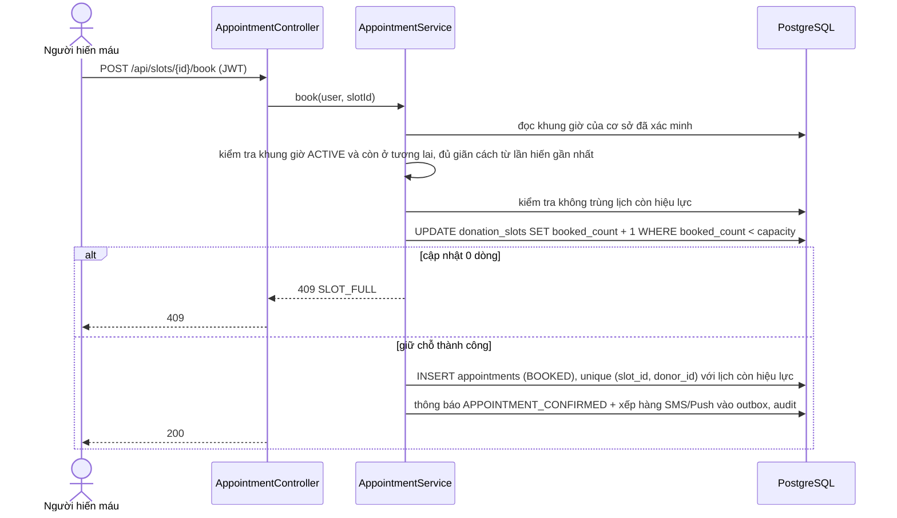
`CHECK (booked_count <= capacity)` ở DB là lưới an toàn cuối cùng. Hủy lịch (trước giờ hẹn ít nhất 2 giờ) trả lại chỗ bằng `booked_count - 1`.

## 11. Sequence: gửi SMS / Web Push qua outbox
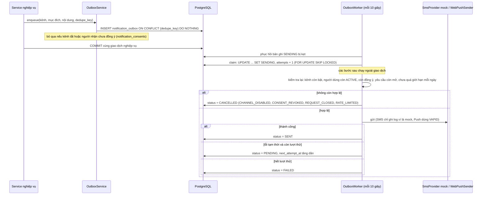
Cơ chế này là *at-least-once*, không bảo đảm *exactly-once* với nhà cung cấp. Kênh `VOICE` (cuộc gọi tự động) đã bị gỡ ở V16: các tin `VOICE` chưa gửi bị hủy, hệ thống không tự gọi điện.

## 12. Use case
```mermaid
flowchart TB
  Guest(("Khách")) --> G1["Xem thống kê, yêu cầu công khai, bản đồ, poster QR"]
  Guest --> G2["Đăng ký / đăng nhập, gồm Google"]
  Guest --> G3["Gửi tin nhắn liên hệ"]

  Donor(("Người hiến máu")) --> U1["Khai báo hồ sơ, nhóm máu, vị trí và quyền riêng tư"]
  Donor --> U2["Bật/tắt trạng thái sẵn sàng"]
  Donor --> U3["Xem lý do được ghép, chấp nhận / từ chối"]
  Donor --> U10["Đặt và hủy lịch hiến máu tại cơ sở đã xác minh"]
  Donor --> U11["Nhập chỉ số sức khỏe và xem sàng lọc sơ bộ, khi đã đồng ý"]
  Donor --> U12["Bật thông báo SMS / Push, nhận nhắc hiến lại"]
  Donor --> U13["Xem lịch sử và mức xác nhận các lần hiến"]

  Requester(("Người cần máu")) --> U4["Tạo và theo dõi yêu cầu realtime"]
  Requester --> U5["Xác nhận người hiến đã hiến, ghi nhận không đến"]
  Requester --> U14["Xem độ phủ người hiến quanh bệnh viện"]
  Requester --> U15["Ghi kết quả liên hệ sau khi gọi người hiến"]
  Requester --> U16["Chia sẻ yêu cầu, in poster QR, báo cáo vi phạm"]

  Org(("Tổ chức y tế")) --> U6["Đăng ký, tải tài liệu xác minh, gửi duyệt"]
  Org --> U7["Xác nhận hoặc từ chối yêu cầu gắn với cơ sở mình"]
  Org --> U17["Quản lý kho máu và sổ biến động"]
  Org --> U18["Mở khung giờ, xử lý lịch hẹn: check-in, sàng lọc, ghi nhận hiến"]
  Org --> U19["Thêm / xóa nhân viên, xem nhật ký hiến và thống kê"]
  Org --> U20["Tạo yêu cầu máu đã xác minh sẵn"]

  Admin(("Quản trị viên")) --> U8["Xác minh hoặc từ chối yêu cầu / tổ chức"]
  Admin --> U9["Quản lý người dùng, báo cáo, nhật ký, thống kê"]
  Admin --> U21["Xem tổng quan kho máu, lịch hẹn, vận hành"]
  Admin --> U22["Xử lý tin nhắn liên hệ, nhận báo cáo tuần qua email"]
```

## 13. Bảo mật theo lớp
| Mối đe dọa | Biện pháp |
|---|---|
| Truy cập trái phép | Access token JWT ngắn hạn (15 phút) trong bộ nhớ trình duyệt; mặc định mọi endpoint cần đăng nhập; `@PreAuthorize` theo vai trò; `/api/admin/**` chỉ ADMIN |
| Đánh cắp phiên | Refresh token xoay vòng, chỉ lưu SHA-256; dùng lại token cũ thì thu hồi cả `family_id`; đổi mật khẩu thu hồi mọi phiên; cookie `httpOnly` + SameSite, `/refresh` và `/logout` đòi header `X-Lifely-Client` |
| IDOR | Service kiểm tra quyền sở hữu (`RequestAccess`, `ownMatch`); trả 404 thay vì 403 để không lộ sự tồn tại |
| Brute-force | Khóa tài khoản 15 phút sau 5 lần sai; `RateLimitFilter` giới hạn theo IP cho đăng ký, đăng nhập, Google, quên / đặt lại mật khẩu, báo cáo, liên hệ, xóa tài khoản |
| Giả mạo đăng nhập Google | Xác thực ID token qua `tokeninfo`, kiểm tra thêm `aud`, `iss`, `exp`, `email_verified` |
| SQL injection | JPA và truy vấn tham số hóa, không nối chuỗi từ dữ liệu người dùng |
| XSS | React tự escape; backend loại bỏ thẻ HTML (`Sanitizer`); header `nosniff`, `X-Frame-Options: DENY`, `Referrer-Policy`, `Permissions-Policy` |
| Tổ chức / yêu cầu giả | Tài liệu xác minh, admin duyệt; yêu cầu cần xác minh (hoặc gắn cơ sở đã xác minh và được cơ sở xác nhận); dùng tọa độ của cơ sở đã xác minh; tối đa 5 yêu cầu mở mỗi người; có báo cáo vi phạm |
| Spam và gửi trùng | Giới hạn tần suất; chống báo cáo trùng; khóa idempotency khi tạo yêu cầu; chống tạo trùng trong 10 phút; `dedupe_key` cho outbox |
| Race condition | `SELECT ... FOR UPDATE` + kiểm tra sau khi khóa + CHECK constraint ở DB; đặt lịch dùng một câu `UPDATE` có điều kiện `booked_count < capacity` |
| Rò rỉ riêng tư | Không trả tọa độ người hiến ra API; API công khai không có số điện thoại; số điện thoại chỉ hiện sau khi người hiến chấp nhận; độ phủ chỉ trả số cụ thể khi từ 3 người trở lên (k-anonymity) |
| Dữ liệu sức khỏe | Chỉ lưu khi có đồng ý; xuất và xóa được; chỉ hiển thị "trong / ngoài ngưỡng", không chẩn đoán |
| Liên lạc ngoài ý muốn | SMS / Push chỉ gửi khi kênh bật **và** người dùng đồng ý, kiểm tra lại ngay trước khi gửi; giới hạn số tin mỗi ngày; không có cuộc gọi tự động |
| Tải lên độc hại | Kiểm tra magic bytes (PDF, PNG, JPG), giới hạn 5 MB, tên file ngẫu nhiên, tải xuống qua endpoint có phân quyền |
| Quyền được xóa dữ liệu | `/api/users/me/export` và `/delete` (yêu cầu mật khẩu hoặc xác thực lại Google); ẩn danh tài khoản và xóa dữ liệu liên quan |

## 14. Class diagram (các lớp chính)
```mermaid
classDiagram
  class User { UUID id; String email; String fullName; String phone; UserStatus status; Set~Role~ roles }
  class DonorProfile { UUID id; BloodType bloodType; BigDecimal latitude; BigDecimal longitude; LocalDate lastDonationDate; AvailabilityStatus availability; String gender }
  class Organization { UUID id; String name; OrgType type; OrgVerificationStatus verificationStatus; boolean inventoryAutoAdd }
  class BloodRequest { UUID id; BloodType bloodType; int unitsRequired; int unitsConfirmed; int unitsReceived; Urgency urgency; RequestStatus status; String facilityReview; int escalationLevel; Instant deadline }
  class Match { UUID id; BigDecimal matchingScore; BigDecimal distanceKm; MatchStatus status; ContactResult contactResult }
  class DonationHistory { UUID id; LocalDate donatedOn; String source; String verificationLevel }
  class Notification { UUID id; NotificationType type; boolean readFlag }

  class RequestService { create() verifyByAdmin() rejectByAdmin() cancel() facilityConfirm() facilityDeny() }
  class RequestLifecycle { transition() note() publish() }
  class RequestAccess { canView() requireViewable() }
  class MatchingService { score() rank() startMatching() escalate() cancelOpenMatches() closeRemainingAfterFulfilled() }
  class ScoreCalculator { score() }
  class MatchService { accept() reject() complete() markNoShow() recordContactResult() }
  class DonorVerificationService { confirmation() badge() }
  class AppointmentService { book() cancel() createSlot() transition() sendDueReminders() }
  class InventoryService { get() update() addDonatedUnit() }
  class NotificationService { notify() markRead() }
  class OutboxService { enqueue() enqueuePush() cancelPending() }
  class OutboxWorker { runOnce() }
  class StaffAlertService { notifyNewRequest() notifyDonorResponded() }
  class AdminAlerts { raise() }
  class RealtimePublisher { onRequestChanged() onNotification() }
  class CoverageService { coverage() }
  class UserDataService { export() deleteAccount() }
  class EscalationJob { run() }
  class RequestExpiryJob { run() }
  class RequestExpiryService { expire() }

  User "1" --> "0..1" DonorProfile
  User "1" --> "0..1" Organization
  User "1" --> "*" BloodRequest : tạo
  Organization "1" --> "*" BloodRequest : liên kết
  BloodRequest "1" --> "*" Match
  DonorProfile "1" --> "*" Match
  DonorProfile "1" --> "*" DonationHistory
  Match "1" --> "0..1" DonationHistory
  User "1" --> "*" Notification

  RequestService --> RequestLifecycle
  RequestService --> RequestAccess
  RequestService --> MatchingService
  RequestService --> StaffAlertService
  RequestService --> AdminAlerts
  MatchService --> RequestLifecycle
  MatchService --> MatchingService
  MatchService --> DonorVerificationService
  MatchService --> InventoryService
  MatchService --> StaffAlertService
  MatchingService --> ScoreCalculator
  MatchingService --> NotificationService
  MatchingService --> OutboxService
  AppointmentService --> InventoryService
  AppointmentService --> OutboxService
  OutboxWorker --> OutboxService
  StaffAlertService --> OutboxService
  EscalationJob --> MatchingService
  RequestExpiryJob --> RequestExpiryService
  RequestExpiryService --> MatchingService
  NotificationService ..> RealtimePublisher : NotificationCreatedEvent sau commit
  RequestLifecycle ..> RealtimePublisher : RequestChangedEvent sau commit
```

## 15. Activity diagram: người hiến phản hồi một yêu cầu
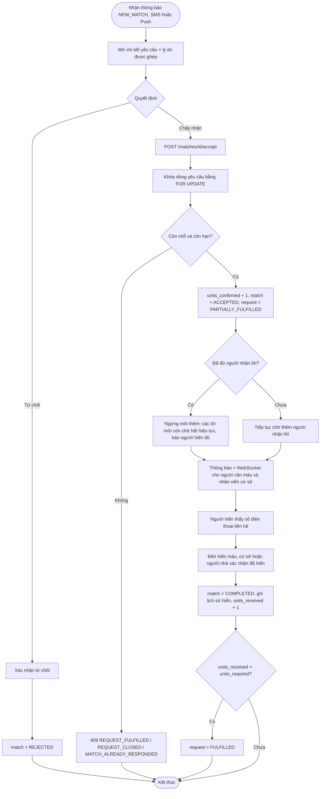

## 16. Activity diagram: leo thang khi chưa đủ người
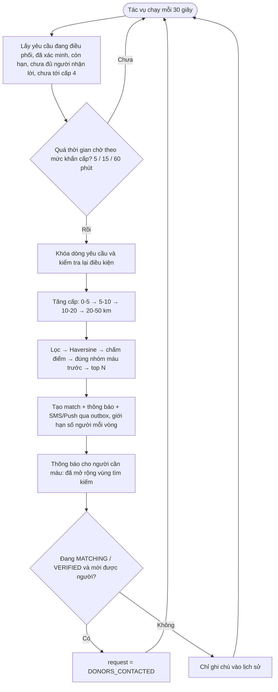
Số người được mời mỗi vòng là `min(15, số còn thiếu × 3)`. Người hiến đã ở cấp trước không bị mời lại (`UNIQUE (request_id, donor_id)`).

## 17. Sequence: đăng nhập bằng Google
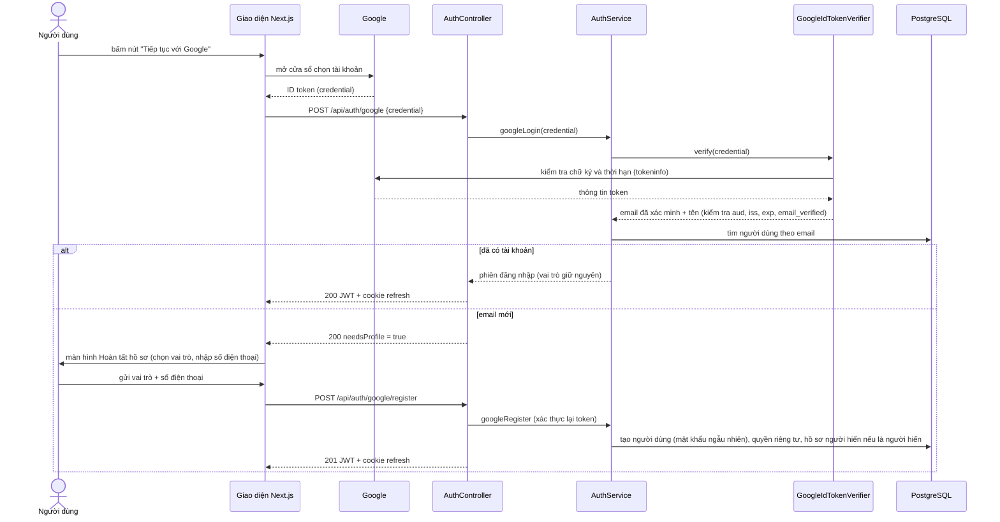
