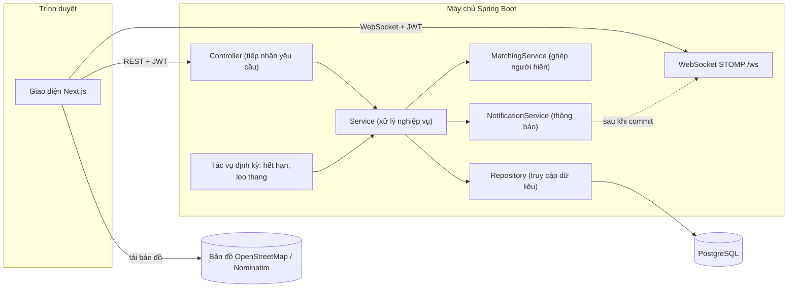
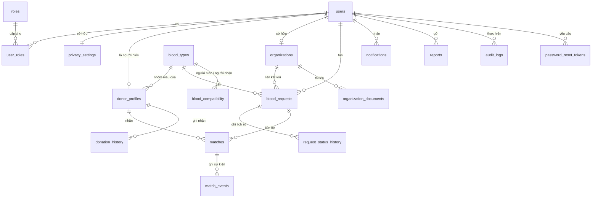
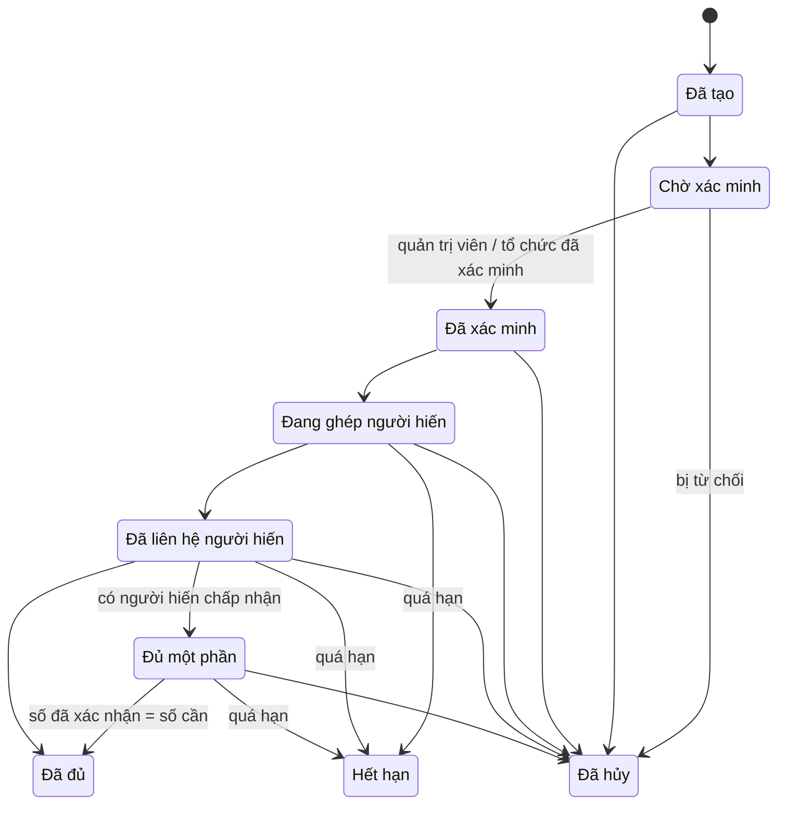
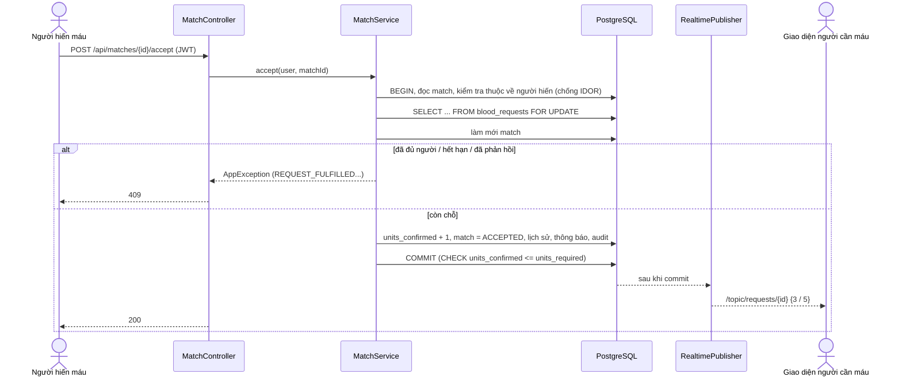
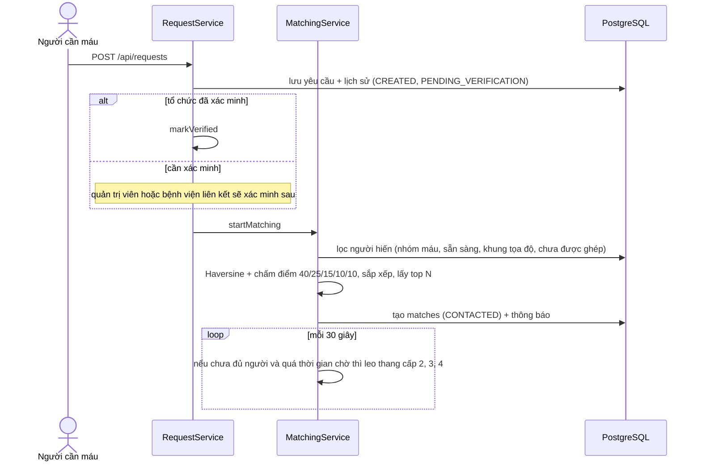
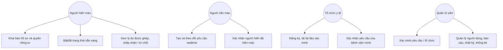
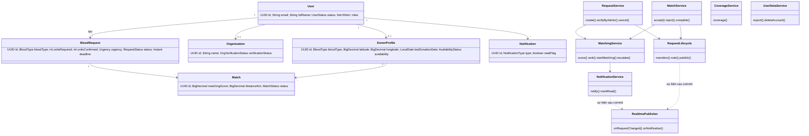
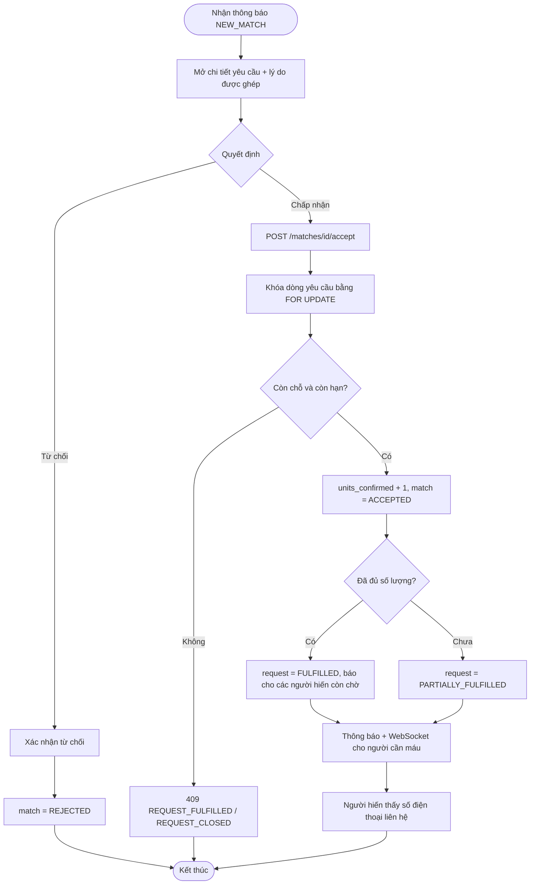

# LIFELY – Kiến trúc và sơ đồ (Mermaid)

Các sơ đồ dưới đây viết bằng Mermaid, xem được trực tiếp trên GitHub hoặc VS Code (extension "Markdown Preview Mermaid Support"), và dùng làm nền để vẽ lại UML trong báo cáo đồ án.

## 1. Kiến trúc hệ thống


## 2. ERD (sơ đồ quan hệ thực thể)


## 3. Vòng đời yêu cầu máu


## 4. Sequence: người hiến chấp nhận (xử lý đồng thời)


## 5. Sequence: tạo yêu cầu → điều phối


## 6. Use case


## 7. Bảo mật theo lớp
| Mối đe dọa | Biện pháp |
|---|---|
| Truy cập trái phép | JWT stateless; mặc định mọi endpoint cần đăng nhập; `@PreAuthorize` theo vai trò |
| IDOR | Service kiểm tra quyền sở hữu; trả 404 thay vì 403 để không lộ sự tồn tại |
| Brute-force | Khóa tài khoản 15 phút sau 5 lần sai + giới hạn tần suất theo IP |
| SQL injection | JPA/truy vấn tham số hóa, không nối chuỗi từ dữ liệu người dùng |
| XSS | React tự escape; backend loại bỏ thẻ HTML; header `nosniff` |
| Tổ chức / yêu cầu giả | Tài liệu xác minh, quản trị viên duyệt; yêu cầu cần xác minh; giới hạn 5 yêu cầu mở mỗi người; có báo cáo vi phạm |
| Spam | Giới hạn tần suất đăng ký/đăng nhập/báo cáo; chống báo cáo trùng |
| Race condition | `SELECT ... FOR UPDATE` + kiểm tra sau khi khóa + CHECK constraint ở DB |
| Rò rỉ riêng tư | Không trả tọa độ người hiến ra API công khai; số điện thoại chỉ hiện sau khi người hiến chấp nhận |
| Tải lên độc hại | Kiểm tra magic bytes, giới hạn 5 MB, tên file ngẫu nhiên, tải xuống qua endpoint có phân quyền |

## 8. Class diagram (các lớp chính)


## 9. Activity diagram: người hiến phản hồi một yêu cầu


## 10. Activity diagram: leo thang khi chưa đủ người
```mermaid
flowchart TD
  S(["Tác vụ chạy mỗi 30 giây"]) --> R["Lấy yêu cầu đang hoạt động, đã xác minh, chưa đủ, còn hạn"]
  R --> D{"Quá thời gian chờ theo mức khẩn cấp?"}
  D -- "Chưa" --> S
  D -- "Rồi" --> L{"Đã ở cấp 4?"}
  L -- "Có" --> S
  L -- "Chưa" --> U["Tăng cấp: 0-5 → 5-10 → 10-20 → 20-50 km"]
  U --> M["Lọc → Haversine → chấm điểm → sắp xếp → top N"]
  M --> C["Tạo match + thông báo, không gửi cho tất cả cùng lúc"]
  C --> T["Thông báo cho người cần máu: đã mở rộng vùng tìm kiếm"] --> S
<<<<<<< HEAD
```

## 11. Sequence: đăng nhập bằng Google
```mermaid
sequenceDiagram
  actor U as Người dùng
  participant FE as Giao diện Next.js
  participant G as Google
  participant API as AuthController
  participant AS as AuthService
  participant V as GoogleIdTokenVerifier
  participant DB as PostgreSQL
  U->>FE: bấm nút "Tiếp tục với Google"
  FE->>G: mở cửa sổ chọn tài khoản
  G-->>FE: ID token (credential)
  FE->>API: POST /api/auth/google {credential}
  API->>AS: googleLogin(credential)
  AS->>V: verify(credential)
  V->>G: kiểm tra chữ ký và thời hạn (tokeninfo)
  G-->>V: thông tin token
  V-->>AS: email đã xác minh + tên (kiểm tra aud, iss, exp)
  AS->>DB: tìm người dùng theo email
  alt đã có tài khoản
    AS-->>API: phiên đăng nhập (vai trò giữ nguyên)
    API-->>FE: 200 JWT + cookie refresh
  else email mới
    API-->>FE: 200 needsProfile = true
    FE->>U: màn hình Hoàn tất hồ sơ (chọn vai trò, nhập số điện thoại)
    U->>FE: gửi vai trò + số điện thoại
    FE->>API: POST /api/auth/google/register
    API->>AS: googleRegister (xác thực lại token)
    AS->>DB: tạo người dùng, quyền riêng tư, hồ sơ người hiến
    API-->>FE: 201 JWT + cookie refresh
  end
=======
>>>>>>> 2d7349796eb3a10c80928b6d467d04aa2e04840e
```
