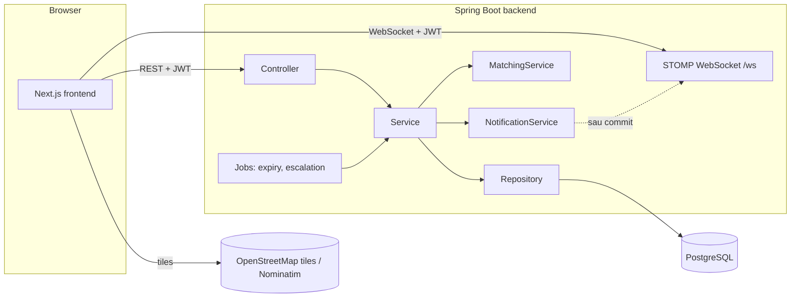
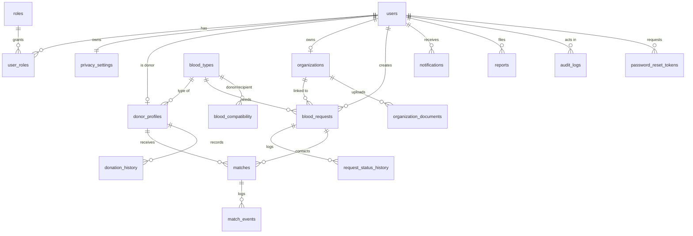
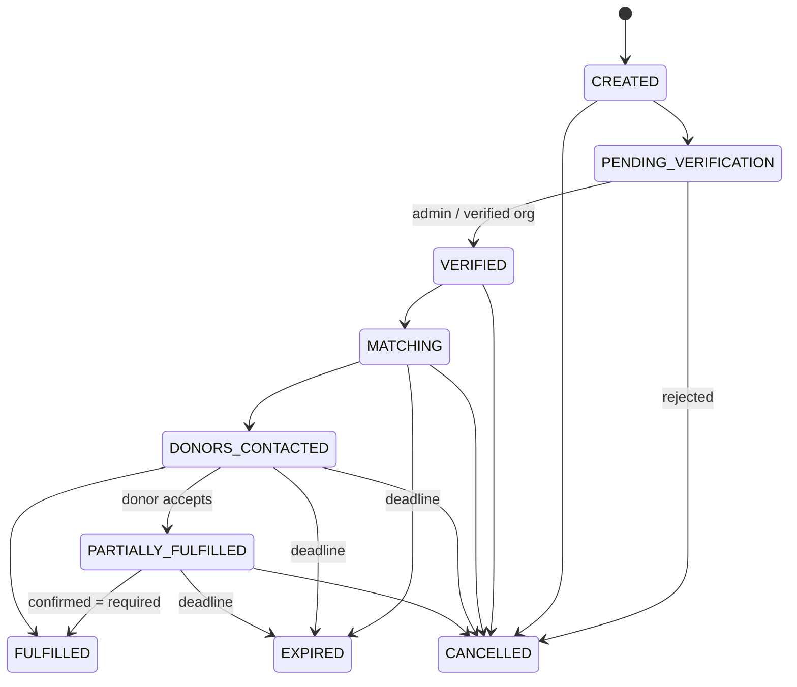
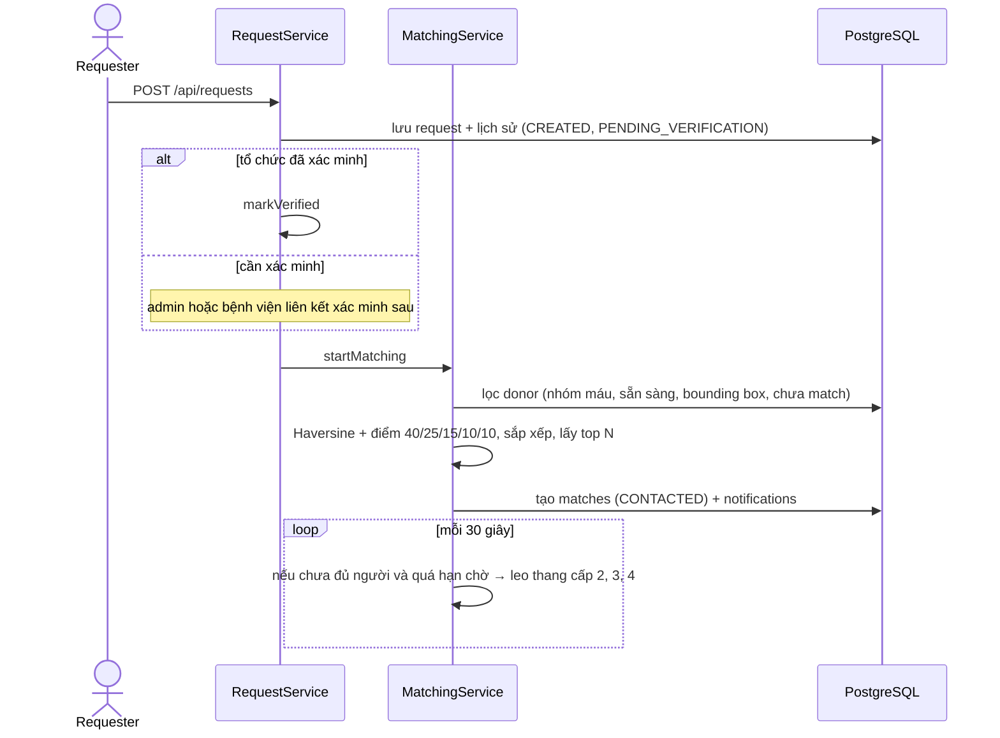
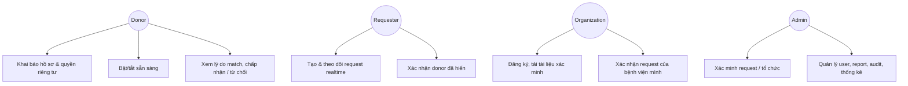

# LIFELY – Kiến trúc và sơ đồ (Mermaid)

Các sơ đồ dưới đây viết bằng Mermaid, xem được trực tiếp trên GitHub hoặc VS Code (extension "Markdown Preview Mermaid Support"), và dùng làm nền để vẽ lại UML trong báo cáo đồ án.

## 1. Kiến trúc hệ thống


## 2. ERD


## 3. Vòng đời request


## 4. Sequence: donor chấp nhận (xử lý đồng thời)
```mermaid
sequenceDiagram
  actor D as Donor
  participant API as MatchController
  participant MS as MatchService
  participant DB as PostgreSQL
  participant WS as RealtimePublisher
  actor R as Requester UI
  D->>API: POST /api/matches/{id}/accept (JWT)
  API->>MS: accept(user, matchId)
  MS->>DB: BEGIN; đọc match, kiểm tra thuộc donor (chống IDOR)
  MS->>DB: SELECT ... FROM blood_requests FOR UPDATE
  MS->>DB: refresh match
  alt đã đủ người / hết hạn / đã phản hồi
    MS-->>API: AppException (REQUEST_FULFILLED...)
    API-->>D: 409
  else còn chỗ
    MS->>DB: units_confirmed + 1, match=ACCEPTED, history, notification, audit
    MS->>DB: COMMIT (CHECK units_confirmed <= units_required)
    DB-->>WS: sau commit
    WS-->>R: /topic/requests/{id} {3 / 5}
    API-->>D: 200
  end
```

## 5. Sequence: tạo request → điều phối


## 6. Use case


## 7. Bảo mật theo lớp
| Mối đe dọa | Biện pháp |
|---|---|
| Truy cập trái phép | JWT stateless; mặc định mọi endpoint cần đăng nhập; `@PreAuthorize` theo role |
| IDOR | Service kiểm tra quyền sở hữu; trả 404 thay vì 403 để không lộ sự tồn tại |
| Brute-force | Khóa tài khoản 15 phút sau 5 lần sai + giới hạn tần suất theo IP |
| SQL injection | JPA/parameterized query, không nối chuỗi từ input |
| XSS | React tự escape; backend loại bỏ thẻ HTML; header `nosniff` |
| Fake organization / request | Tài liệu xác minh, admin duyệt; request cần xác minh; giới hạn 5 request mở / người; report |
| Spam | Rate limit đăng ký/đăng nhập/report; chống report trùng |
| Race condition | `SELECT ... FOR UPDATE` + kiểm tra sau khóa + CHECK constraint ở DB |
| Rò rỉ riêng tư | Không trả tọa độ donor ra API công khai; SĐT chỉ hiện sau khi donor chấp nhận |
| Upload độc hại | Kiểm tra magic bytes, giới hạn 5 MB, tên file ngẫu nhiên, tải qua endpoint có phân quyền |
