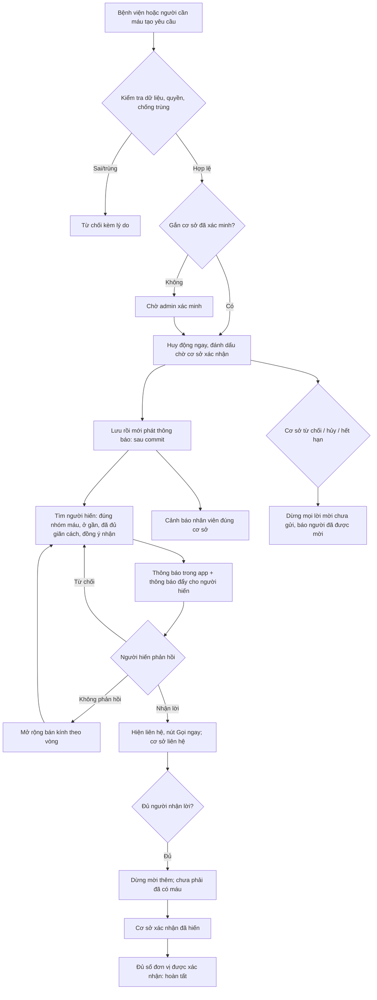
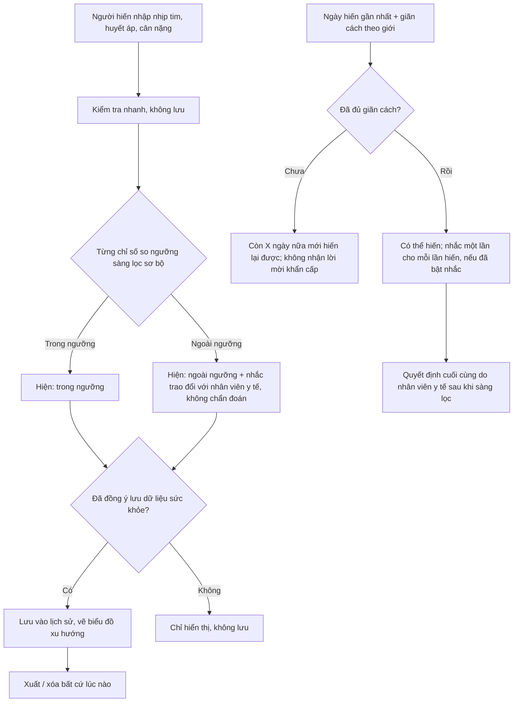

# Nội dung cập nhật cho báo cáo và slide

> Chỉ là dàn ý và đoạn văn gợi ý để nhóm chỉnh. Con số nào chưa kiểm chứng đã được ghi rõ. **Dữ liệu trong đồ án là dữ liệu giả; ngưỡng sàng lọc là giả định tham khảo, không phải khuyến cáo y tế.**

## 1. Giới thiệu, mục tiêu, phạm vi (đề xuất viết lại theo tên "Webapp")
**Tên đề tài gợi ý:** *LIFELY – Webapp điều phối người hiến máu khẩn cấp, hỗ trợ đặt lịch hiến và sàng lọc sơ bộ*

**Giới thiệu.** Khi bệnh viện hoặc người nhà cần máu gấp, việc tìm người hiến phù hợp, ở gần và sẵn sàng thường dựa vào nhắn tin truyền miệng, chậm và khó theo dõi. LIFELY là ứng dụng web (cài được lên điện thoại dưới dạng PWA) kết nối người cần máu, cơ sở y tế và người hiến máu tình nguyện, đồng thời hỗ trợ đặt lịch hiến trước và nhắc hiến lại.

**Mục tiêu.**
1. Huy động nhanh người hiến phù hợp (nhóm máu, khoảng cách, đủ giãn cách) khi có yêu cầu khẩn cấp và thông báo tức thì qua ứng dụng và thông báo đẩy.
2. Cho phép đặt lịch hiến máu trước tại cơ sở đã xác minh, không vượt sức chứa kể cả khi nhiều người đặt cùng lúc.
3. Tách bạch *người nhận lời*, *lịch hẹn* và *lượng máu thực tế được cơ sở xác nhận*; kho máu chỉ thay đổi sau xác nhận của cơ sở.
4. Hỗ trợ người hiến theo dõi sức khỏe sơ bộ và biết khi nào có thể hiến lại, với dữ liệu thuộc quyền kiểm soát của họ.

**Phạm vi.** Webapp (PWA), backend, cơ sở dữ liệu, thông báo trong ứng dụng, email và thông báo đẩy. SMS: có khung tích hợp và chế độ giả lập. Không có cuộc gọi tự động: nhân viên bệnh viện gọi thủ công bằng liên kết `tel:` và tự ghi nhận kết quả liên hệ. **Ngoài phạm vi:** ứng dụng native, thiết bị y tế thật, thanh toán, kết nối hệ thống bệnh viện (HIS), chẩn đoán y khoa, kiểm thử tải.

## 2. Sơ đồ luồng

### 2.1 Luồng khẩn cấp

### 2.2 Luồng kiểm tra đủ điều kiện sơ bộ và hiến lại

## 3. Bảng chức năng
| Chức năng | Đã hoàn thành (đã chạy thật) | Chưa kiểm chứng | Ngoài phạm vi / hướng phát triển |
|---|---|---|---|
| Cơ sở dữ liệu V1–V15 | Chạy sạch trên PostgreSQL 16 trống | – | – |
| Đặt lịch không vượt sức chứa | 25 phiên song song đặt 5 chỗ: đúng 5 thành công (SQL) | Qua code Java (`AppointmentConcurrencyIT`) | Hàng đợi chờ khi hết chỗ |
| Outbox thông báo (chống trùng, retry, dừng khi yêu cầu đóng) | SQL: dedupe, claim `SKIP LOCKED`, retry, hủy | Qua worker Java (`OutboxIT`) | Đảm bảo exactly-once (không thể với SMS) |
| Web Push (mã hóa RFC 8291 + VAPID) | Đối chiếu thư viện độc lập `http_ece`/`web-push`: 12/12; gửi tới dịch vụ push giả: 13/13 | **Gửi tới Chrome/Safari/Firefox thật**, hiển thị trên điện thoại | Push có hình, nút hành động |
| Ngưỡng sàng lọc và giãn cách | Chạy thật 24/24 trường hợp biên (Java thuần) | Qua API/Spring | Thêm Hb, tiền sử bệnh, thuốc |
| Trang Sức khỏe của tôi, biểu đồ, xuất, xóa | Giao diện build và test thành công (76 test); SQL consent/xóa | Chạy trên trình duyệt thật cùng backend | Nhập từ thiết bị đo |
| Nhắc hiến lại | SQL: nhắc đúng một lần mỗi lần hiến, tôn trọng bật/tắt và giới tính | Job Java + push thật | Nhắc lại sau X ngày |
| Xóa tài khoản xóa cả dữ liệu mới | SQL chạy thật | Luồng Java đầu-cuối | – |
| PWA: cài đặt, trang ngoại tuyến, service worker | Manifest, icon, header, trang offline phục vụ đúng (chạy `next start`) | **Cài và thử trên iPhone, Android thật** | Đồng bộ nền, APK TWA |
| Dữ liệu demo giả, seed/clear | Chạy 2 lần không nhân đôi; xóa sạch kể cả dữ liệu phát sinh | – | – |
| SMS | Khung adapter, chế độ giả lập, đồng ý, giới hạn | **Nhà cung cấp thật** | Chọn nhà cung cấp, mẫu tin được nhà mạng duyệt |
| Toàn bộ backend Java | Cú pháp biên dịch được (javac, không thư viện) | **`mvn test`, mọi `*IT`, chạy ứng dụng** | – |
| App native / APK | – | Chưa build | Bọc TWA, Capacitor |

## 4. Trả lời các câu hỏi dễ bị hỏi
**Vì sao PWA mà không phải app native?** Một mã nguồn chạy mọi thiết bị, cài từ đường dẫn, cập nhật tức thì, không qua cửa hàng ứng dụng, miễn phí và phù hợp thời gian đồ án. PWA có thông báo đẩy chuẩn Web Push và chạy toàn màn hình khi đã cài. Hạn chế nhóm biết: iPhone chỉ nhận thông báo đẩy khi đã "Thêm vào MH chính" (iOS 16.4 trở lên); truy cập phần cứng bị giới hạn hơn native. Hướng phát triển: bọc PWA thành APK (TWA/Capacitor) mà không viết lại.

**Vì sao không tự động gọi điện cho người hiến?** (1) Cần nhà cung cấp, chi phí và mẫu tin được nhà mạng duyệt, chưa nằm trong ngân sách đồ án; (2) tự động gọi dễ gây phiền và có rủi ro với quy định về tin nhắn/cuộc gọi rác, nên chỉ làm khi người dùng đồng ý; (3) hệ thống ưu tiên thông báo trong app, thông báo đẩy và nút **Gọi ngay** để người có trách nhiệm gọi trực tiếp; (4) khung tích hợp SMS/cuộc gọi đã sẵn, đang ở chế độ giả lập, bật được khi có nhà cung cấp.

**Dữ liệu sức khỏe được bảo vệ ra sao?** Chỉ lưu khi người dùng đồng ý và rút lại được; chỉ chính họ xem (không có API cho vai trò khác); xóa và xuất bất cứ lúc nào; xóa tài khoản xóa luôn dữ liệu này; không ghi giá trị vào log hay nhật ký; truyền qua HTTPS. Hạn chế: chưa mã hóa mức trường, chưa có chính sách tự hết hạn (xem `SECURITY_REVIEW.md`). Dữ liệu trong đồ án là giả.

**Ngưỡng sàng lọc lấy từ đâu?** Tham chiếu Thông tư 26/2013/TT-BYT qua các nguồn tổng hợp: nhịp tim 60–90, huyết áp tâm thu từ 100 đến dưới 160, cân nặng tối thiểu 42 kg (nữ) và 45 kg (nam), giãn cách 12 tuần. Nhóm **chưa đối chiếu bản gốc còn hiệu lực**; ngưỡng tâm trương là giá trị tạm. Tất cả chỉnh được bằng cấu hình và cần cơ sở y tế xác nhận. Ứng dụng chỉ là hỗ trợ sàng lọc sơ bộ, không chẩn đoán; quyết định cuối do nhân viên y tế.

**Điều gì xảy ra khi người hiến không phản hồi?** Lời mời hết hiệu lực theo thời gian; tác vụ định kỳ mở rộng bán kính tìm theo từng vòng (5, 10, 20, 50 km) và mời thêm người; số lời mời có giới hạn để không làm phiền. Nếu hết hạn mà chưa đủ người, yêu cầu chuyển "hết hạn" và người tạo được báo. Người đã nhận lời nhưng không đến có thể được cơ sở đóng lượt ("Không đến") để mở lại chỗ trống. Với ca nguy kịch, ứng dụng nhắc gọi cấp cứu 115 và hotline hỗ trợ. *(Mô tả theo code; chưa chạy kiểm thử đầu-cuối vì backend chưa compile trong môi trường làm việc.)*

## 5. Đề cương slide (11 trang)
1. **Tiêu đề và đội nhóm**: tên webapp, khẩu hiệu "Kết nối. Hiến máu. Cứu một sinh mạng.", thành viên.
2. **Vấn đề**: tìm người hiến máu khẩn cấp hiện nay chậm, thiếu theo dõi; số liệu minh họa phải có nguồn.
3. **Giải pháp và phạm vi**: ba nhóm người dùng; hai luồng (khẩn cấp, đặt lịch); điều LIFELY *không* làm (không chẩn đoán, không thay cơ sở y tế).
4. **Kiến trúc**: Next.js (PWA) – Spring Boot – PostgreSQL; outbox; Web Push; sơ đồ khối.
5. **Luồng khẩn cấp** (sơ đồ 2.1) và nguyên tắc "nhận lời ≠ có máu".
6. **Đặt lịch và kho máu**: không vượt sức chứa (kết quả 25 phiên song song), trạng thái lịch, chỉ xác nhận mới cộng kho.
7. **Sức khỏe của tôi và hiến lại** (sơ đồ 2.2): ngưỡng sơ bộ, biểu đồ, nhắc hiến lại.
8. **Thông báo**: trong app, thông báo đẩy (kiểm chứng), email; SMS/gọi giả lập; đồng ý theo kênh; chống trùng.
9. **Bảo mật và quyền riêng tư**: ai xem được gì, đồng ý, xóa/xuất, chống SSRF, điểm cần cải thiện.
10. **Kiểm thử và kết quả thật**: bảng mục 3 (đã chạy thật / chưa kiểm chứng) và trung thực về giới hạn.
11. **Demo trực tiếp**, rồi **hạn chế, hướng phát triển và cảm ơn**: SMS/gọi thật, APK, ngưỡng do cơ sở y tế xác nhận, kiểm thử tải.
